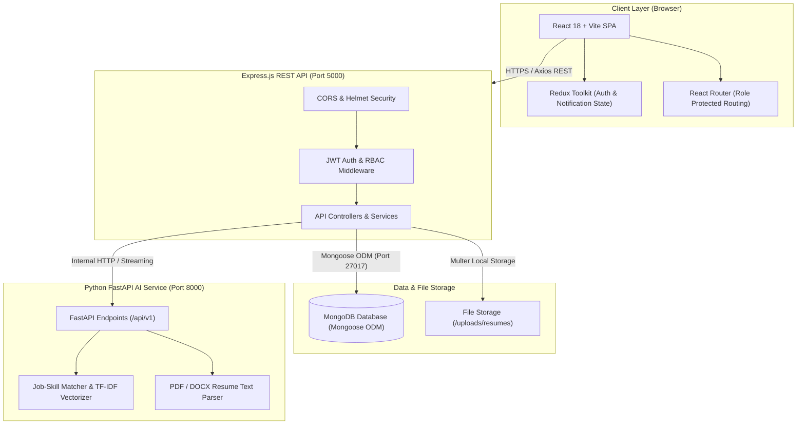
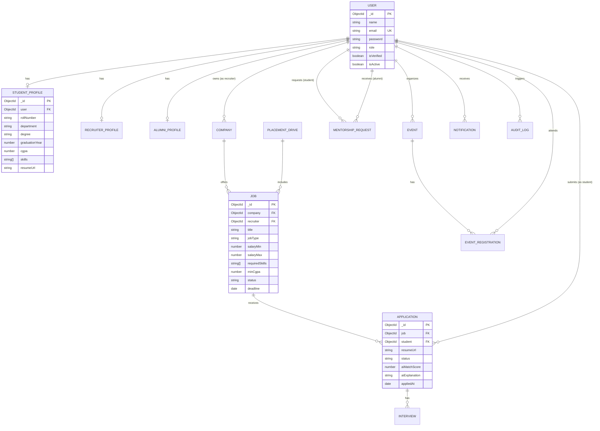
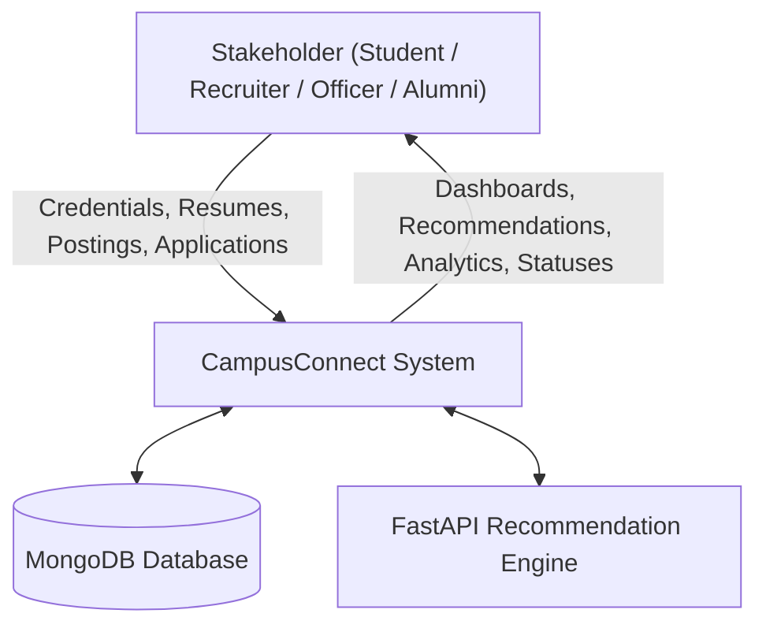
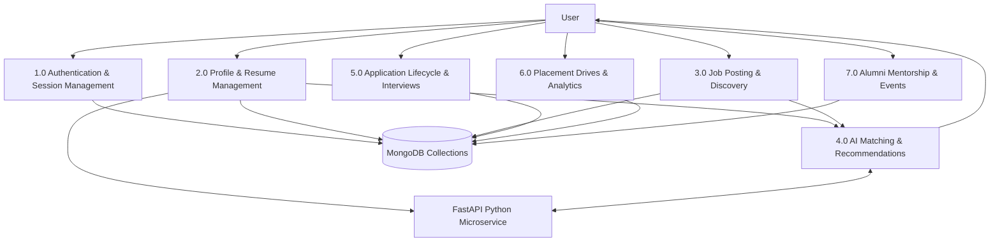
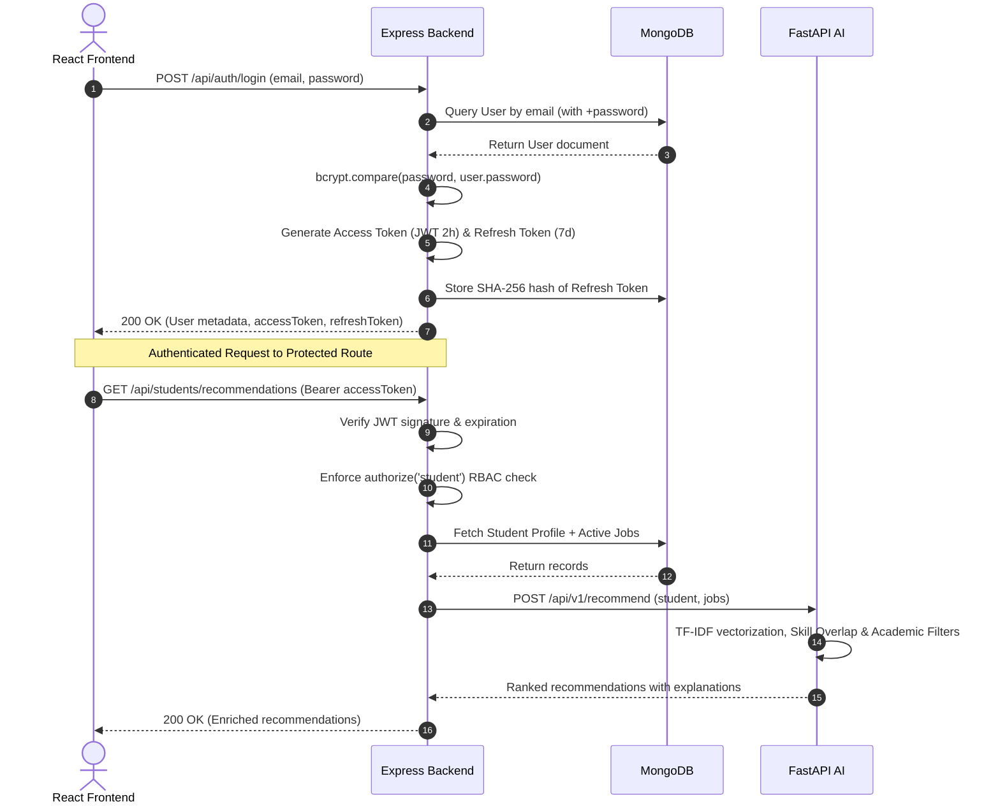

# System Architecture & Technical Diagrams

## 1. System Architecture Diagram

The CampusConnect platform utilizes a decoupled microservices architecture with a dedicated client SPA, main business logic backend, database storage layer, and an AI recommendation microservice.



---

## 2. Use Case Diagram

```mermaid
graph LR
    actor Student as "Student"
    actor Recruiter as "Recruiter"
    actor Officer as "Placement Officer"
    actor Alumni as "Alumni Mentor"

    subgraph CampusConnectPlatform ["CampusConnect Platform Use Cases"]
        UC1["Register & Authenticate"]
        UC2["Upload Resume & View AI Parse"]
        UC3["Browse Eligible Openings"]
        UC4["View AI Recommendations & Skill Gap"]
        UC5["Submit / Withdraw Application"]
        UC6["Post & Manage Campus Jobs"]
        UC7["Review Applicants & Download CSV"]
        UC8["Schedule Interviews"]
        UC9["Verify Recruiters & Alumni"]
        UC10["Manage Placement Drives"]
        UC11["View Real-Time DB Analytics"]
        UC12["Inspect Audit Logs"]
        UC13["Update Mentorship Availability"]
        UC14["Respond to Mentorship Requests"]
        UC15["Host Workshops & Register Events"]
    end

    Student --> UC1
    Student --> UC2
    Student --> UC3
    Student --> UC4
    Student --> UC5
    Student --> UC15

    Recruiter --> UC1
    Recruiter --> UC6
    Recruiter --> UC7
    Recruiter --> UC8

    Officer --> UC1
    Officer --> UC9
    Officer --> UC10
    Officer --> UC11
    Officer --> UC12

    Alumni --> UC1
    Alumni --> UC13
    Alumni --> UC14
    Alumni --> UC15
```

---

## 3. Entity Relationship (ER) Diagram



---

## 4. Data Flow Diagram (DFD Level 0 & Level 1)

### Level 0 DFD (Context Diagram)



### Level 1 DFD (Process Decomposition)



---

## 5. Authentication & Authorization Sequence Diagram


